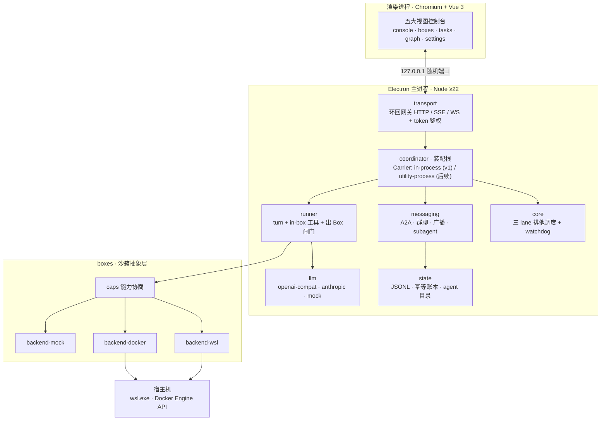

# OpenBot 架构总纲

> **版本** v1.4 · 2026-10-20 · 状态：已与作者对齐
> **v1.1 变更**：新增 §3.5 主从模型（一主多从，唯一管家 Steward），联动 §3.2 / §5 / §8 / ADR #11
> **v1.2 变更**：新增 §8「解耦纪律」七条硬规则（UI 与逻辑边界从结构性保证升级为显式条款），§5 补「协议只含领域事实」
> **v1.3 变更**（2026-10-18/19 语义入档）：§3.5 群聊发言模式体系（#前缀注册表）与身份分层（persona）；§3.6/§7 群轮过程记录归群流；§7 会话段栈语义与 settings/profile additive 字段清单
> **v1.4 变更**：新增 §3.9 插件运行时（MCP client + manifest 声明面 + tools/上行事件双能力面——设计全案 [docs/plan-plugins.md](docs/plan-plugins.md)）
> **上游文档**：[PRODUCT.md](PRODUCT.md)（产品定位）· [DESIGN.md](DESIGN.md)（视觉基调）· `prototype.html`（视觉母版）
> **本文地位**：架构唯一权威。与代码冲突时，两者必须同步修改，不允许文档与实现长期分叉。

---

## 0. 一页总览

OpenBot = **不依赖云电脑的 GrokBot**。原版把重活丢给云端 VM，OpenBot 把执行层换成本机沙箱（Box）；
交互主轴是多 agent 社交控制台，载体是 Electron 桌面应用，Windows 优先，Linux/macOS 预留。



六条架构原则（所有后续决策的裁判）：

1. **本地优先** —— 断公网核心能力全部可用；LLM 可换本地 Ollama（openai-compatible 一口通吃）。
2. **执行进 Box** —— agent 的重任务（构建、改项目、跑脚本）全部在沙箱内执行；出 Box（宿主文件/网络）必须过闸门。
3. **壳与内核解耦** —— `packages/*` 不 import Electron；壳（desktop/cli/未来浏览器）只通过 HTTP/SSE/WS 说话。换壳零改动。
4. **边界由编译器强制** —— 八个包，依赖只许向下，循环依赖是构建错误而非 code review 侥幸。
5. **能力协商而非统一承诺** —— 沙箱后端能力天然不对齐（见 §6），一切下游（工具可用性、UI 按钮）由 `caps` 单一真相源驱动。
6. **Clean-room** —— 架构可借鉴（OpenGrokBot/Grok Bot），代码全部自研，Apache-2.0（见 §12）。

---

## 1. 进程拓扑

### v1（当前形态）：单进程内核 + 外部沙箱

```
┌─────────────────────────────────────────────────┐
│ Electron app                                     │
│  ├─ 渲染进程（Chromium, sandbox 开启）            │
│  └─ 主进程                                       │
│      ├─ transport   环回 HTTP+SSE+WS 网关         │
│      └─ coordinator 装配根（in-process Carrier）  │
│          └─ kernel（core/state/messaging/runner） │
└──────────────┬──────────────────────────────────┘
               │ 子进程 / API 调用
   wsl.exe ────┤        Docker Engine API
   （WSL2 发行版）        （容器）
```

- **coordinator 以模块形式跑在主进程内**（`InProcessCarrier`，直接函数调用），不拆 utility process。
- Box 是外部执行体：WSL2 发行版（经 `wsl.exe`）、Docker 容器（经 Docker Engine API）。
- 原版三平面（control/data/mainData）在 v1 折叠为 bus 上的**逻辑通道**，概念保留——为未来拆进程留 1:1 映射。

### 后续（触发条件明确后才做）：utility process 拆分

`coordinator` 定义 `Carrier` 接口（`start / request / event`），两个实现：

- `InProcessCarrier` —— v1，直接调用；
- `UtilityProcessCarrier` —— 需要崩溃隔离/内核独立升级时再写，transport 补 MessagePort 帧协议。

**拆进程是部署开关，不是架构手术。** kernel 代码永远不知道自己跑在哪种载体上。

---

## 2. 包结构与依赖规则

八个包 + 三个壳。依赖关系（只许向下）：

```
core        ← 谁都不依赖（纯逻辑，无 I/O）
llm         ← 谁都不依赖
state       ← core（只借事件类型）
boxes       ← core（只借事件类型）
transport   ← core（事件族定义）
messaging   ← core, state
runner      ← core, state, messaging, llm, boxes   ← 唯一同时认识「消息」和「执行」的包
coordinator ← 以上全部（全项目唯一被允许全知的装配根）
```

三条铁律：

1. **依赖只许向下**；循环依赖 = 构建失败。
2. **coordinator 是唯一装配根**——全项目只有它 import 全家；业务代码互相之间不横向装配。
3. **壳只许 import transport 的客户端**——desktop/cli 的业务代码不直接 import kernel 任何包。

粒度说明：这八包保留了 OpenGrokBot 的包边界（编译期硬边界 + 每层独立可测），
但**内容全部为 OpenBot 重写**（执行基座从云 VM/宿主 daemon 换成本机沙箱，贯穿所有层）。映射表见 §12。

---

## 3. 各包详设

### 3.1 `core` —— 调度内核（纯逻辑，无 I/O）

- 三 lane 排他队列：每 agent 同一时刻一个活跃 turn，`user > agent > background`，用户消息永远最先。
- watchdog + zombie 逃逸：卡死 run 过 grace 窗口后逃逸，调用方 promise 立即返回（发送永不悬挂）。
- RunLifecycle、ack 义务、重试/期限/空闲策略、事件总线。
- 事件类型表新增 `box`、`approval` 两个族（原版没有）。

### 3.2 `state` —— 持久化

- 每 agent 独立目录：`transcript.jsonl / memory.json / automations.json / profile.json / settings.json / group.json`（memory 已实现——backlog ①：可演化工作集与 transcript 的 append-only 账本语义分界）。
- **角色与唯一性事务**：profile 增加 `role`（steward 管家 / worker 工人，默认 worker）；任命 / 罢免 / 转移为排他事务（复用排他变更锁），**全局唯一 steward 不变量在 store 层强制**——同一册内第二个任命直接拒绝（见 §3.5 主从模型）。
- **幂等账本**：clientNonce + inputDigest，超时重试零双发。durable acceptance 使发送与执行解耦。
- etag 钩子保留（条件写），**BCS 多端同步整块推 P6**。
- 薄薄的 box 目录存储（box 实例清单、快照索引、模板注册）。
- **镜像注册表**（plan-image-firstclass P8-3 + P8-4；P9-1 起 host-screen 载体；P9-3a 起
  windows 载体）：`<root>/images.json`——镜像条目 = 载体类型（容器/SSH 主机/宿主屏幕/Windows
  主机）+ 连接事实 + 控制协议（'x11' | 'none' | 'host' | 'win'）
  + 显示地址；路由后端（RoutingBoxBackend）按 `BoxSpec.image`（条目 id）分发到对应后端实例，
  'default' 落全局后端——**Agent 绑定镜像而非后端实例**（P8-4 已兑现：`AgentProfile.imageId`，
  addAgent 即按绑定分发创建 Box；悬空回默认 + 告警；命令面悬空显式拒绝），services/工具族持
  单一 backend 引用零改动。**宿主屏幕载体（P9-1/P9-2）**：纯屏幕 Box（零连接事实，稳定
  boxId `hostscreen-<entryId>`——每条目一 box，窗口绑定条目是不同的桌面面）——无命令执行面
  （exec/fs 稳定码拒绝），桌面控制经 HostScreenControl（desktopCapturer 截屏 + PowerShell
  SendInput 注入 + 窗口绑定 EnumWindows/GetWindowRect，Electron 面由装配层 bridge 注入、
  boxes 零 electron 依赖）；实况流三档探测（L1 ffmpeg h264 > L2 getUserMedia 帧泵 > L0
  desktopCapturer 轮询——`streamTier` 单一事实源）；**输入注入恒过审批闸**（runner
  actionGate——「Box 内自由」在用户本机屏幕上不成立）；kernel.screen 为 ScreenControlRouter
  （按 boxId 分发 X11/宿主屏幕），消费方零载体感知。**Windows 机内载体（P9-3a）**：SSH 可达的
  Windows 目标机（OpenSSH Server + 密钥免密）——exec 走 `powershell -EncodedCommand`（UTF-16LE
  单 token，env/cwd 内联编码）；GUI = PowerShell CopyFromScreen 截屏 + SendInput 注入（注入
  脚本与宿主屏幕**逐字节同一份**，win-protocol 共享核心经 openPipe 通道传输）；实况 = 远端
  PS 捕获循环 b64 行帧（mjpeg）；远端整机 isolation high——**不经**宿主屏幕的审批闸（agent
  在目标机内 exec/注入 = Box 内自由）。**Android 设备载体（P9-3b）**：adb 可达的 Android 设备
  （USB 调试 / wifi adb）——POSIX（mksh）远端脚本/fs 构造**直接复用 backend-ssh**；GUI =
  设备内建工具三件套（`wm size` 几何 / `screencap` PNG 截图 1:1 坐标系 / `input` 注入——
  type 仅 ASCII、组合键仅单修饰，如实边界）；实况 = `screenrecord --output-format=h264raw`
  直出 Annex B（真 h264——WebCodecs 管线零改动）；独立设备 isolation high，不经本机审批闸。
- **全局 settings.json v2（2026-09-15 供应商 1:N 模型）**：供应商 = 端点事实（baseUrl/协议/key/代理）
  + `models[]`（模型 id + 模型级 `supportsImages`——截图回喂格式语义从供应商级下沉随模型走）；
  默认粒度 = 供应商 + 模型（`defaultProvider` + `defaultModel`）。v1 单模型文件读取端迁移
  （`model` → `models[0]`，写回即 v2，零破坏）；per-agent 覆盖 `modelProvider` 兼容
  `供应商::模型` 复合键（旧值纯供应商名解析取其默认模型，零迁移）。
- 继任路线：规模到瓶颈时迁移 `node:sqlite`（Electron 内置 Node 自带，无原生编译）；JSONL 始终是 transcript 源头真相。

### 3.3 `llm` —— 模型接入（自研薄客户端）

- provider 抽象 + 确定性 mock（测试地基）。
- `openai-compatible`：fetch + SSE 解析，零 SDK，覆盖 OpenAI / DeepSeek / 豆包 / Moonshot / GLM / Grok / **Ollama / vLLM**。
- `anthropic`：单独 provider。
- **自定义 base_url + 代理设置是国内刚需**——走中转访问 Anthropic 是常态，做不好第一个差评就是它。

### 3.4 `boxes` —— 沙箱抽象层（OpenBot 独有）

见 §6 专章。

### 3.5 `messaging` —— agent 社交

**主从模型（一主多从 · 唯一管家 Steward）**——组织层新增约束，贯穿本包所有机制：

- **角色**：每个 agent `role ∈ { steward, worker }`，默认 worker。**同一 agent 名册内任一时刻至多一个 steward**（唯一管家不变量，由 state 层排他事务强制，见 §3.2）。
- **默认路由**：用户消息不指定收件人时路由给 steward；steward 空缺时进入**空缺态**——不自动提拔（用户主权），默认路由退化为显式 @，UI 提示任命。
- **steward 的权力 = 委派，不是特权**：
  - 可 A2A 唤醒 / steer 任意 worker；可派生 subagent（复用 lineage）；可发起广播（扇出权仅限用户与 steward，worker 不能广播）；
  - **无任何权限提升**——出 Box 闸门照走审批；三 lane 排他不变，steward 不能中断 worker 正在执行的 user lane 任务；调度上 steward 与 worker 同优先级。**权力在委派拓扑，不在资源抢占。**
- **主从只作用于委派与路由，不作用于通信**：worker 仍是全功能节点——可主动 A2A 给 steward 或其他 worker、可被 @、可进群。一主多从限定的是「谁替用户分活」，不是「谁允许说话」。
- **群聊保持 leaderless**：有界轮转语义不变，steward 在群里只是普通成员（可发起群，但非天然群主）——层级停留在委派层，不进群聊协议。
- **图谱**：graph 视图中委派边（steward → worker）与既有消息边并存。
- **继任**：steward 被删除或休眠 → 空缺态，用户任命新 steward 后恢复默认路由；transcript 与委派边历史保留。

- A2A 私聊：fire-and-forget + 对称唤醒；priority 消息可中断接收方非用户工作（steer）；DM 抢占后 at-least-once 重驱（isRedriven 防环）；双侧 transcript 镜像 + 社交图谱数据。
- 群聊编排：有界轮转（消息上限/轮次上限/全员 pass 收敛/用户消息 supersede）、@提及路由（**双命中面**：`@agentId` 与 `@显示名` 都路由——用户不知道 agentId，渲染层补全插的是显示名）、每成员独立会话状态。
- **发言模式体系**（2026-10-18/19）：`#xxx ` 前缀触发，内核 `GROUP_MODE_PREFIXES` 注册表解析（前缀剥离 + group-user 记录留 mode 痕），协议 schema 零改动——新模式同位追加。已注册：
  - `#讨论`/`#独立`（independent）：全员并发入队、context 恒空（互不可见各抒己见）、settle 不推进、全员结算收敛；
  - `#汇总`（summary）：阶段一盲答（同 independent）→ 阶段二汇总人交叉总结（**管家优先**，GroupDeps.roleOf 装配注入；带全量观点 context）→ settle 收敛；
  - `#点名`（mention）：门控——仅被 @ 的成员应答（轮转语义保留）；空点名回退轮转并注记。
- **身份分层**（2026-10-18）：`AgentProfile.persona`（人设一句话，ctx 档案可编辑、即时生效）+ `roleName`（角色档位名——呈现留档，权限语义恒在 role）。系统提示词按 agent 分流：worker 以「你是「名字」（人设）……不是管家」开场（全局一句「你是管家」致 worker 集体自认管家是已被实证修复的缺陷）。**自定义角色模板**（`settings.roleTemplates`：name + persona，v1.roles.* 命令族，上限 20）：小红书运维/微商运营等用户自建档位，建 Agent 时选用复用；内置四角色（管家/研究员/工程师/观察员）代码内建不落库。群轮 prompt 注入成员身份行与同伴名单（经 agentMeta——装配层档案真相缓存，任命事务经 roster 事件随动）。
- 广播：→全员单向扇出，顺序调度、并发执行、无环（发起方：用户与 steward，见上）。
- subagent：父 agent 派生后台 run，lineage 世系、steer、abort。
- `CrossUserRelay`（跨用户房间）：turn-request/result、10 分钟窗口 30 turn 预算、不可达退避、nonce 幂等——**已实现（P7；协议与自托管指南 [docs/relay-protocol.md](docs/relay-protocol.md)，本地优先/P2P 优先措辞见其 §0）**。
- 云 agent 桥：**接口桩，保留协议默认不用**（产品定位写死；后续可接第三方云做弹性补充）。
- 删除原版 WebAuthn provider 契约（原版遗物，与 OpenBot 无关）。

### 3.6 `runner` —— turn 执行与工具层

- turn 执行、SendMessage 解析、SessionRuntime / GroupMemberRunner 装配。
- **群轮过程记录归群流**（2026-10-18 裁定）：群成员 turn 的 thinking/exec 过程记录落**群 transcript**（键 = groupId——「会话键 = 呈现归属」，成员私聊档案零群痕迹）；ToolContext 携带 sessionKey 落盘键。群视图无过程卡（呈现裁定），过程数据随群流留档。
- **工具层为 OpenBot 重写**：
  - *in-box 工具族*（默认）：exec / fs 读写 / 构建 / snapshot，全部经 boxes 在沙箱内执行，Box 内自由。
  - *host 最小工具集*：仅限进程自身状态（读 transcript、消息收发、**记忆 save/recall**——backlog ①：agent 自己的工作集，不出 Box 概念面），**出 Box（宿主文件/网络）一律过闸门**。
  - *computer 工具族*（沙箱内 GUI 操作——plan-computer-use 一期已实现，P8-2 接口化）：
    screenshot/click/type/key/scroll 只认 **ScreenControl 适配器接口**（boxes/screen）——
    「截图/点击/键入/实况采集」按镜像/载体类型提供适配器（X11 适配器 = xdotool/scrot/ffmpeg
    命令原样迁入；RDP/厂商 API 适配器随真机接入定形），工具族与 GuiStreamService 零具体命令
    依赖。与 exec 同级「Box 内自由」零新审批面；注册门 = GUI 工具集探测 ∩ provider 视觉声明
    （env OPENBOT_COMPUTER=1 保留为强制门）；用户接管锁（GUI 视图首笔输入挂起 agent 下一个动作，
    「交还」放行）是壳层内存态。
- **闸门（gate）在本包**：审批流 = runner 拦截 → transport 发 `approval` 事件 → renderer 弹窗 → 结果回写。
  审批复用 state 幂等账本（nonce）——重试不双弹窗、不双执行。原版账本设计为 OpenBot 闸门服务，是架构继承里最划算的回收。

### 3.7 `transport` —— 壳与内核之间唯一的边界

- **in-process bus**（v1 第一载体）：类型化事件总线 + 异步 RPC。
- **环回网关**：`POST /api/*` 控制面 + `GET /events` SSE 事件流 + `WS /stream` 数据面，协议详见 §5。
- 断线重连、sendPrompt 幂等重试语义保留。
- 删除原版 MessagePort 帧协议（无进程分离则不需要；utility 拆分时再补）。

### 3.8 `coordinator` —— 装配根

- 唯一 import 全家的包：把 core/state/llm/boxes/messaging/runner 装配成可用系统，对 transport 暴露统一表面。
- Carrier 抽象（in-process / utility-process），见 §1。
- 监督契约：v1 表现为 core watchdog 对 run 的逃逸；utility 拆分后升级为退出码契约 + 指数退避重启。
- 删除原版双载体（parent-port/fork-ipc）的多路复用细节——那是进程边界才需要的复杂度。

---

### 3.9 `plugins` —— 插件运行时（coordinator 服务模块，P1 已实施）

**设计全案见 [docs/plan-plugins.md](docs/plan-plugins.md)（作者裁定记录在内）。要点：**

- **形态**：协议进程（stdio MCP）为主、声明式包为辅；进程内模块**永久否决**（供应链/崩溃隔离/净室）。
- **协议两层**：内核做 **MCP client**（工具面：initialize 握手 / tools/list / tools/call），OpenBot **manifest** 管声明面（id/entry/permissions/events/agents 绑定，manifestVersion 版本演进）。语言无关——任何语言的 MCP server + manifest.json 即插件。
- **能力面（P1）**：`tools`（MCP 工具经装配门注册进 ToolRegistry，工具名前缀 = id 尾段；**全部过审批闸门**——第三方代码默认不信任）+ **上行事件**（插件 JSON-RPC notification `openbot/event` → `v1.plugin.event` 事件 → 按 manifest 路由：用户通知（toast）/ 唤醒绑定 Agent（复用 messaging.sendUserMessage + 幂等 nonce `plugin-event:<id>:<seq>`，事件风暴不双驱））。
- **红线**：插件对 transcript 只读、不绕闸门、不发 UI 指令、不提权（一票否决项）。
- **进程管理**：懒启动（纯工具插件）或启用即启（事件源插件）→ 空闲回收（纯工具插件）→ 崩溃限次重启（超限标记故障态如实呈现）——插件挂了内核无感。
- **分发（本地优先）**：市场 = 静态索引（内置官方目录，P2 远端 URL）+ 安装 = 拷贝到 `<root>/plugins/<id>/`（`installedPlugins` 台账续用）——无后端、无账号，纯客户端底色。
- **mock 对称**：MockMcpServer 测试桩（单测 spawn 真实 stdio 握手）+ 示例插件 `hello-events`（E2E 全链：安装 → Agent 调工具 → 事件上行通知）。

## 4. 壳（apps/）

| 壳 | 状态 | 职责 |
|---|---|---|
| `apps/desktop` | **第一交付** | Electron：main（装配 coordinator + 网关）/ preload（contextBridge 注入 token）/ renderer（Vue 3 五大视图）。托盘常驻、自启动、自动更新 |
| `apps/cli` | P1 | 无壳冒烟：mock llm + mock box 跑全链路（chat → A2A → box exec）。**CI 全确定性的地基**，也是「packages 壳无关」的活证据 |
| `apps/relay` | **P7 已实现** | 跨用户房间公网 host（Hono 控制面 + ws 数据面，自托管——官方不运营服务；[docs/relay-protocol.md](docs/relay-protocol.md)） |

---

## 5. 传输协议

### 三通道

| 通道 | 用途 | 说明 |
|---|---|---|
| `POST /api/*` | 控制面 | 请求/响应，全部幂等可重试（nonce） |
| `GET /events` | 事件流 | SSE，七族事件实时推送，Last-Event-ID 续传 |
| `WS /stream` | 数据面 | **OpenBot 新增**：Box 实况帧（10–30fps）、文件传输。二进制帧 + 背压。SSE 纯文本单向，撑不住数据面——明知需要就第一天设计进去。已接入三源：run 实况（frames）/ PTY 会话流（pty）/ GUI 桌面实况（gui，plan-computer-use 二期——30fps mjpeg，背压即降帧只补最新帧） |

### 事件目录（我们自己的，带版本前缀）

七族：`v1.lifecycle`（run 生命周期）/ `v1.message`（对话与 A2A）/ `v1.task`（任务与产物）/
`v1.box`（沙箱状态与 caps）/ `v1.approval`（闸门审批）/ `v1.graph`（社交图谱，委派边与消息边并存）/ `v1.system`（roster 与角色变更等）。
P7 做 relay 时这就是线上协议，不二次发明。

协议里只有**领域事实与命令**，永远没有 UI 指令——「打开弹窗 / 刷新视图 / 选中某项」不进协议，UI 对事件的呈现反应是渲染层自治决定。错误与状态传稳定 code（如 `BOX_SNAPSHOT_UNSUPPORTED`），不传文案；文案与多语言归渲染层。内核代码里不出现 UI 字符串。

### 环回安全（本机网关是真实攻击面）

1. 只绑 `127.0.0.1`，**随机端口**；
2. preload 经 contextBridge 注入 bearer token，所有请求必带；
3. 校验 `Host` 头（防 DNS rebinding）；renderer 开 `sandbox` + `contextIsolation`，CSP 收紧；
4. 渲染远端房间内容（跨用户消息）必须过 DOMPurify。
5. **公网 relay 面（P7）**：invite 码认证 + 房间隔离 + 限速 + 消息上限（朴素版如实——
   [docs/relay-protocol.md](docs/relay-protocol.md) §5 安全基线表）；TLS 交反代/Tailscale 隧道；
   turn-request 是远端触达本端执行面的唯一通道（受控进入，走既有排队与审批闸门）。

---

## 6. 执行层：boxes（专章）

### 三态执行模型

| 态 | 范围 | 权限 |
|---|---|---|
| **Box 内**（默认） | 沙箱文件系统、网络按模板策略 | 自由 |
| **宿主机** | 进程自身状态、消息 | 最小工具集；**出 Box（宿主文件/网络）一律审批** |
| **云** | 接口桩 | 协议保留，默认关闭 |

### caps 能力协商（单一真相源）

`BoxBackend.caps` 返回能力对象，三处消费一个来源，永不出现「UI 有按钮但后端不支持」：

- runner：按 caps 决定工具可用性（无快照能力的 Box 不注册 snapshot 工具）；
- transport：caps 随 `v1.box` 事件下发；
- renderer：按 caps 渲染按钮。

### 后端矩阵（诚实版）

| 能力 | WSL2 | Docker | Podman | Windows Sandbox | nspawn (Linux·P6 已实现) | UTM (macOS·P6 已实现) | SSH 主机（P8-1 已实现） | 宿主屏幕（P9-1 已实现） | Windows 机内（P9-3a 已实现） | Android 设备（P9-3b 已实现） | mock |
|---|---|---|---|---|---|---|---|---|---|---|
| 持久化 | ✓ | 需卷挂载 | 需卷挂载 | ✗ 关闭即焚 | ✓（/var/lib/machines） | ✓（VM 注册） | ✓（用户资产——create=attach / teardown=断开，绝不销毁远端） | ✓（屏幕预存在——attach 记账零副作用） | ✓（机器预存在——attach 记账零副作用） | ✓（设备预存在——attach 记账零副作用） | 假装 ✓ |
| 快照 | `--export` 整盘打包，GB 级、慢 | 镜像分层 | 镜像分层（commit） | ✗ | ✓（export-tar） | ✓（clone/delete 链——载体是 VM 克隆） | ✗（vmrun 快照链随 P8-5 组合后端） | ✗（用户桌面不可快照） | ✗（远端机器无快照原语——vmrun 链随 P8-5） | ✗（设备无快照原语） | ✓ |
| 资源上限 | **全局 .wslconfig，无法按 Box 限制**；所有 Box 共享一个 vmmem | ✓ 严格 | ✓ cgroups v2（rootless 可用） | 粗粒度 | ✓（set-property 真落 cgroup） | ✗（utmctl 无配置入口——如实） | ✗（远端机器资源归用户/云厂商） | ✗（本机资源归用户） | ✗（远端机器资源归用户/云厂商） | ✗（设备资源归用户） | 假装 ✓ |
| 隔离强度 | 弱（/mnt/c 直通、9P 慢） | 中 | 中（rootless 无 daemon） | 强 | 中 | 强（VM 级） | 强（载体是整机 VM/云主机） | **零隔离（用户本机——输入注入恒过审批闸）** | 高（远端独立整机——注入不经本机审批闸） | 高（独立设备——注入不经本机审批闸） | —— |
| 无人值守 | ✓ | ✓ | ✓（podman machine） | ✗ 无法 headless | 部分（写操作需 root/polkit） | 部分（exec 依赖 guest agent） | ✓（密钥免密 + BatchMode） | 部分（看屏自由、注入恒过闸） | ✓（密钥免密 + BatchMode；桌面须保持登录态——GUI 面） | ✓（USB 调试/wifi adb；屏幕点亮——GUI 面） | ✓ |
| 交互终端（PTY） | ✓ Box 内 `script` 真 PTY | ✓ 容器内 script PTY | ✓ 容器内 script PTY | —— | 设计支持（宿主侧 PTY 边界真机待验） | ✗（utmctl attach 未实现） | ✓（`ssh -tt` 远端 sshd 分配真 PTY） | ✗（无 shell 可开——零 shell 面） | ✓（`ssh -tt` + 远端 powershell 交互；无 stty——80×24 缺省记档） | ✓（`adb -tt shell` 设备端 mksh 真 PTY） | ✓ 回显假终端 |
| 可用性 | Win10/11 全版本 | 需 Docker Desktop（企业要付费授权） | 免费开源；Windows 经 podman machine（**自身占一个 WSL2 发行版**） | **仅 Pro/Enterprise，Home 版没有**（作者本机即 Home） | Linux（systemd 自带） | macOS（UTM app + GUI 会话） | 全平台（OpenSSH 客户端；**显式偏好 opt-in——auto 序永不含 ssh**，远端机器不是本地沙箱） | Windows 宿主（PowerShell + SendInput；**注册即显式 opt-in**，注入恒过闸） | 全平台（目标机装 OpenSSH Server；注册即显式 opt-in） | 全平台（adb CLI；USB 调试/wifi adb；注册即显式 opt-in） | 全平台 |

**结论写死在架构里**：十载体矩阵齐——WSL2 + Docker + Podman + **nspawn + UTM** + **SSH 主机**（plan-image-firstclass P8-1，机器即 Box 的首个非容器载体）+ **宿主屏幕**（plan-screen-firstclass P9-1，屏幕即 Box 的首个零执行面载体——「屏幕一等公民」的第一步：人类经远程控制看到的一切都落在宿主屏幕上）+ **Windows 机内**（P9-3a，云电脑/VMWare Windows 终极目标的结构化正路——PS 协议 over SSH）+ **Android 设备**（P9-3b，adb 即接口——设备内建 screencap/input/screenrecord 零预装，screenrecord h264raw 直用解码管线）+ mock（Podman 提前进 v1：2026-08-19 用户裁定，消解 Docker Desktop 授权地雷；docker/podman CLI 同构共用 OCI 容器底座；nspawn/utm 随 P6 兑现——CLI 底座 + 脚本化单测 + 探测呈现，真机链路如实记未验收；SSH 载体是「镜像一等公民」阶段一的验证轮——`exec` 通道抽象普适性的实证）；Windows Sandbox 降级为「Pro 用户可选的强隔离后端」（P5 后视需求）。接口按 caps 设计，永远不按「最强后端都能做什么」设计。

**attach 语义（SSH 载体，2026-09-12 裁定 C）**：远端机器是用户资产——`create` = 连通验证 + 记账（附工作目录初始化），`teardown` = 断开记账，**绝不触碰远端**；同一后端实例对应一台机器（单一 boxId，多 agent 复用）。这一语义是「镜像一等公民」（plan-image-firstclass 阶段三）的载体生命周期基调：OpenBot 只做「接入-操控-断开」。

### 接口草图

```ts
interface BoxBackend {
  readonly id: string;
  caps(): BoxCaps;                       // persistent / snapshot / headless / resourceLimits / isolation / interactive
  create(spec: BoxSpec): Promise<BoxId>;
  exec(box: BoxId, cmd: ExecSpec): Promise<ExecResult>;      // 含流式输出；ExecSpec.signal 触发即终止命令（run 取消/抢占传导）
  fsRead/fsWrite(box: BoxId, path, ...): Promise<...>;
  snapshot(box: BoxId): Promise<SnapshotId>;
  stats(box: BoxId): Promise<BoxStats>;  // CPU/内存/磁盘（字段可选：缺席=后端不可测——WSL 只有磁盘 vhdx 真值）；StatsService 定时轮询发 v1.box.stats，并据注入的宿主磁盘探针做压力判定（派生量归内核）发 v1.system.pressure
  teardown(box: BoxId): Promise<void>;
  openShell?(box: BoxId, opts?): Promise<ShellSession>;      // 交互式终端（PTY；caps.interactive=true 必须实现）
}
```

**用户中止的信号传导（用户主权）**：`v1.scheduler.cancel` → 调度器 `controller.abort()` → `run.signal` 沿三层传播——llm 轮（provider fetch 的 AbortSignal）、exec 轮（`ToolContext.signal` → `ExecSpec.signal` → procexec kill 子进程）、审批挂起（`gated()` 的 signal race；run 以 aborted 结算时装配层把该 run 的未决审批按 denied 落账——中止即否决，账本不孤儿）。

**PTY 交互终端（2026-08-20 用户裁定从 P4 提前进 P3）**：用户亲手在 Box 内敲命令（操作台大屏，xterm.js 渲染），与 agent 的 exec 路线（run/审批/预算）完全分离。WSL 后端用 Box 内 `script` 分配真终端——**PTY 在 Linux 侧，Windows 侧零原生模块**；键入走环回命令面（`v1.boxes.shellOpen/Write/Close`，每键几字节），输出走 WS `/stream` 的 `kind:'pty'` 流。一期固定尺寸 100×30（管道方案无 TIOCSWINSZ，中途 stty 会干扰运行中程序）。

### mock 对称

`backend-mock` 与 `llm` 的 mock 形成对称：调度 → 消息 → 工具 → 执行**全链路在无 WSL/Docker 的 CI 上确定性跑通**。这两个 mock 是八层结构可测性的地基。

---

## 7. 状态与持久化

- **源头真相**：transcript 永远 JSONL（append-only、崩溃安全、可 grep、可人工检查）。
- 每 agent 一目录（§3.2），agent 目录、memory、automations 平铺 JSON。
- **幂等账本**贯穿三条链路：消息发送（重试零双发）、任务提交、**闸门审批**。
- **会话段栈语义**（2026-10-18 对齐）：session-start 压栈 / session-resume 弹栈或带目标回溯（目标之后时间线失效）——`sessionView`（组装解释器）、`sessionSegments`（清单/清扫/标题触发共用段扫描）、`extractSession`（quote 注入）三处同构。`session-title` 记录（首答后异步生成 ≤20 字标题，fire-and-forget 失败静默）；空会话不落边界（v1.session.clear 当前段无消息时 no-op）。
- **settings/profile 的 additive 字段**（版本号 + 读取端兼容，零破坏迁移）：`settings.json` —— providers/relays 之外新增 `roleTemplates`（自定义角色）与 `installedPlugins`（插件安装态，v1.plugins.*）；`profile.json` —— `persona` / `roleName`。均为可选字段，旧文件读取 = 缺席语义。
- box 目录（实例/快照/模板）走同一套 JSONL/JSON 约定。
- 禁止原生依赖进 state（better-sqlite3 等）——保持 electron-builder 零 rebuild、Electron 升级零成本。
- API key 用 Electron `safeStorage`（Windows 即 DPAPI）加密落盘，不明文。

---

## 8. 渲染层

**解耦纪律（硬规则）**——UI 与逻辑的边界不只靠「壳只走网关」的结构保证，以下条款在 code review 中一票否决：

1. **状态归属二分**：内核事实（七族事件可表达的：roster、transcript、任务、Box、审批）归内核；渲染局部态（当前视图、选中项、抽屉开合、草稿、过滤条件）归 renderer——后者永不上行，丢弃无代价。
2. **单向流**：命令进（`POST /api`）、事件出（SSE/WS）。内核永不发 UI 指令（见 §5），渲染层不直改内核状态，只能发命令。
3. **派生计算归位**：会进协议的派生量（未读数、磁盘压力判定、图谱聚合）由内核算——它是事实；纯表现派生（排序、分组、配色、格式化）由渲染层算。同一条数据两边各算一个口径必错。
4. **乐观更新带 nonce**：渲染层可乐观渲染，必须标 pending，以 nonce 关联内核事件回填或回滚——幂等账本顺便解决了 UI 侧去重。
5. **视图可重建**：任何视图都是 transcript/JSONL + 事件流的纯函数投影。回放 / 时间旅行天然可用——这是解耦是否干净的试金石。
6. **测试对称**：内核测试零 DOM；渲染层测试对内存版 transport 客户端跑，无 Electron——mock 网关与 mock llm / mock box 同列。
7. **壳等价判据**：cli 与 desktop 共用同一命令面。任何功能「只有 desktop 能用」即解耦已破，当 bug 处理。

- **Vue 3**（`<script setup lang="ts">`）+ Pinia + Vite + @vueuse。决策理由：
  1. `prototype.html` 每个组件本来就是 markup + `<style>` + 脚本三段式，与 SFC 一一对应——原型是迁移底稿而不是废稿；
  2. 响应式系统从根上消灭原型阶段踩过两次的 innerHTML 重渲染丢事件 bug 类（SSE 实时推送下这本会是系统性风险）；
  3. 中文生态一等公民，单人开发效率与未来贡献者池最大。
- 五大视图对齐原型：`console`（对话流+执行卡）/ `boxes` / `tasks`（三 lane 队列）/ `graph`（社交图谱）/ `settings`。
- console 默认收件人 = 管家（steward）；名册带角色徽标；空缺态顶栏提示任命（§3.5 主从模型）。
- renderer **无特权**：sandbox 开启，只经环回网关说话，不碰 Node。渲染 markdown 一律 markdown-it + DOMPurify。
- 该选择不锁死：渲染层只说 HTTP/SSE/WS，未来加浏览器壳/换框架，`packages/*` 一行不动。

---

## 9. 技术选型清单

| 层 | 选型 | 一句话理由 |
|---|---|---|
| 语言 | TypeScript（strict）全栈 | 主进程/preload/renderer/relay 一种语言，统一性的根基 |
| 许可证 | **Apache-2.0** | 自研代码自主授权；带专利授权，利于接收贡献与商用 |
| 壳 | Electron（最新稳定版） | Node 直接复用内核、三平台同渲染引擎、child_process 调 wsl/docker |
| 包管理 | pnpm + workspaces | 快、严格隔离（无幽灵依赖）、国内镜像友好 |
| 后端包构建 | 纯 tsc（project references），无 bundler | 运行时即 Node，零打包层 |
| 渲染层 | Vue 3 + Pinia + Vite | §8 |
| 壳↔内核 | 环回 HTTP + SSE + **WS** 三通道 | 控制面/事件流/数据面各归其位 |
| 持久化 | JSONL + 每 agent JSON 目录 | 零原生依赖；node:sqlite 钦定继任 |
| LLM | 自研薄客户端 + zod 校验 | openai-compat 通吃，代理/base_url 刚需 |
| 沙箱 | dockerode + wsl.exe 子进程 | 全走公开接口，无平台 SDK |
| 测试 | Vitest（单测）+ Playwright `_electron`（E2E） | 原型阶段手搓 CDP 的痛，以后是一行 `launch()` |
| 打包 | electron-builder（nsis+portable）+ electron-updater + Azure Trusted Signing | 签名月付 ~$10，否则 SmartScreen 拦用户 |
| Lint/格式 | ESLint 9 flat + Prettier + eslint-plugin-vue | 常规军 |

---

## 10. 目录树

```
OpenBot/
├─ package.json / pnpm-workspace.yaml / tsconfig.base.json / .npmrc
├─ PRODUCT.md · DESIGN.md · ARCHITECTURE.md（本文）· prototype.html
├─ docs/
│  ├─ architecture.md     （本文的 docs 副本或拆分细节）
│  ├─ protocol.md         （三通道 wire 格式 + 七族事件 schema）
│  ├─ platforms.md        （三平台沙箱矩阵 = §6 后端矩阵展开）
│  └─ cleanroom.md        （借鉴边界声明与致谢）
├─ packages/
│  ├─ core/         src/sched(lane·watchdog·zombie) · lifecycle · events
│  ├─ state/        src/transcript · ledger · memory · automations · agent-store · box-catalog
│  ├─ llm/          src/openai-compat · anthropic · mock
│  ├─ boxes/        src/types(caps) · registry · backend-wsl · backend-docker · backend-mock · images
│  ├─ messaging/    src/a2a · group · broadcast · subagent · xuser(P6) · cloud-stub
│  ├─ runner/       src/turn · tools(in-box) · gate · approval
│  ├─ transport/    src/bus · gateway(http/sse/ws) · auth · events(七族)
│  └─ coordinator/  src/assemble · carriers(inproc · utility) · supervise
├─ apps/
│  ├─ cli/          冒烟与 CI：mock llm + mock box 全链路
│  ├─ desktop/      main · preload · renderer(Vue3) · resources · electron-builder.yml
│  └─ relay/        P7 已实现（跨用户房间 host，自托管）
└─ tools/           build / publish 脚本
```

Windows-first 的约束收敛在三处：`packages/boxes`（wsl/docker 后端）、`apps/desktop`（打包目标先只开 win nsis+portable）、`docs/platforms.md`（矩阵）。Linux/macOS 落地 = 在既有接口下**新增文件**，不改既有结构。

---

## 11. 路线图

| 阶段 | 内容 | 验收标准 |
|---|---|---|
| **P0 骨架** | pnpm workspaces + 八包门面（package.json/tsconfig/空导出）+ docs 四篇开篇 | `pnpm i && pnpm typecheck && pnpm test`（空测试）全绿 |
| **P1 内核走通（无壳）** | core + state + llm(mock) + runner + transport(bus) + boxes(mock) + coordinator(in-proc)，apps/cli | cli 演示 chat → A2A → box exec(mock) 全链路，确定性，CI 绿 |
| **P2 桌面** | Electron 壳 + 网关(SSE/WS) + Vue renderer 五视图接真数据 + 闸门 UI + caps UI | 原型视觉对齐；Playwright `_electron` E2E 绿 |
| **P3 真实后端** | backend-wsl + backend-docker + backend-podman（OCI 底座共用）+ 快照/资源统计/磁盘压力告警 + 流式双线（llm/exec/PTY）+ Windows 打包签名 | 真实 Box 内完成一次「改项目→构建」任务并产出 diff；操作台 PTY 真机可用 |
| **P4 原型对齐收敛** | 差距清零：命令面板（Ctrl K）/ @提及 / toast / 状态栏 / 新建 agent 向导 / Box 休眠与快照回滚 / ctx 档案 / 演示值清扫（2026-08-25 用户裁定重定位——原「平台扩展」顺延 P5、relay 顺延 P6；细案 [docs/plan-p4.md](docs/plan-p4.md)） | prototype.html 差距盘点逐项「已实现 / 记档裁定」二态收敛；三命令 + E2E 全绿 |
| **P5 消息域收敛 + OCI 双壳** | 广播（@全员/@多提及——扇出调度是内核语义）+ 群聊（有界轮转/sysnote/群组节点）+ backend-docker/backend-podman（OCI 底座共用两薄壳——v1 四后端收官；细案 [docs/plan-p5.md](docs/plan-p5.md)）（2026-08-26 用户裁定重排——原「平台扩展」顺延 P6、relay 顺延 P7） | @全员与群聊 E2E 全链路；四后端矩阵如实标注；三命令 + E2E 全绿 |
| **P6 平台扩展与分发** | backend-nspawn/backend-utm（CLI 底座 + 脚本化单测 + 探测呈现——真机链路记未验收）、平台化装配（probeAll/AUTO_ORDER 按平台）、electron-builder 打包链（main/preload esbuild 预 bundle 消解 pnpm workspace 收集坑；win nsis/portable 真机产物；linux deb/AppImage + mac dmg 配置就绪记「待设备」——2026-09-01 裁定 A；细案 [docs/plan-p6.md](docs/plan-p6.md)） | win 双产物真机装卸闭环 + E2E 打包产物全链；win 上不出现 nspawn/UTM（探测事实驱动）；三命令 + E2E 全绿 |
| **P7 relay** | 跨用户房间公网 host（Hono 控制面 + ws 数据面，自托管 node/Docker 双形态）+ CrossUserRelay 实现（信封/预算/幂等/退避四件套兑现——host 是预算与幂等单一事实源）+ 桌面接入（RelayClient 退避重连/mirror 双向/远端 turn 受控进入走审批闸门——2026-09-01 裁定 B/C/D）+ 名册远端节/远端消息卡/设置页房间区块 + E2E 真 host 全链（含 DOMPurify 净化断言）；细案 [docs/plan-p7.md](docs/plan-p7.md) | P2P/Tailscale 优先叙事落地（[relay-protocol.md](docs/relay-protocol.md) §0 钉死）；E2E 全链 + 三命令全绿 |

注：P1 是八包结构直接送的礼物——**不装 Electron 就能验证整个内核**，这是保留包边界的直接回报。

---

## 12. 架构渊源与 clean-room 纪律

### 借鉴映射（OpenGrokBot → OpenBot）

| OpenGrokBot（GPL-3.0） | OpenBot（Apache-2.0） | 关系 |
|---|---|---|
| `core` | `packages/core` | 架构继承：排他调度/watchdog 语义；代码自研 |
| `coordinator` | `packages/coordinator` | 继承装配根与监督思想；载体从双进程载体改为 in-process/utility；**v1 不拆进程** |
| `transport` | `packages/transport` | 继承网关与幂等重试语义；删 MessagePort 帧，**加 WS 数据面**与环回鉴权；local-exec 生态位被 boxes 取代 |
| `state` | `packages/state` | 继承 JSONL/账本设计；BCS 推 P6；**账本被复用于审批闸门** |
| `messaging` | `packages/messaging` | 继承 A2A/群聊/广播/subagent 协议语义；xuser 推 P6；云桥降为桩；删 WebAuthn 契约 |
| `llm` | `packages/llm` | 职责相同，自研薄客户端 |
| `runner` | `packages/runner` | 继承 turn/SendMessage；**工具层重写为 in-box + 闸门** |
| —— | `packages/boxes` | **OpenBot 独有**：执行基座从云 VM/宿主 daemon 换成本机沙箱，产品定义本身 |
| `apps/demo` | `apps/cli` | 同角色（无壳冒烟） |
| `apps/console` | `apps/desktop` 的 renderer | 原则继承：壳只说 HTTP/SSE(/WS) |

### clean-room 三条纪律（Apache-2.0 的前提）

1. **参考库只读不拷**——open-grokbot-main 永远不进 OpenBot 的 import 图；
2. **命名与文件结构按 OpenBot 自己的语义**——不镜像参考库模块名；
3. **`docs/cleanroom.md` 写致谢与边界声明**——架构、协议语义、调度策略不受版权保护，代码受；参考库自己也以同样方式致谢 Grok Bot，这是这个圈子的礼貌。

---

## 13. 风险与已知地雷登记

| # | 风险/地雷 | 缓解 |
|---|---|---|
| 1 | Electron 常驻内存（150–250MB）+ WSL2 vmmem（1GB+）叠加 | 接受（换内核零改造）；托盘「挂起时释放」记 backlog |
| 2 | WSL2 全局性：所有 Box 共享一个 VM、`wsl --shutdown` 全杀、无按 Box 资源上限、快照=整盘 export | caps 如实标注；文档明示；重任务建议 Docker 后端 |
| 3 | Docker Desktop 企业授权收费 | 文档标注免费边界（个人/小团队）；P5 评估 podman socket 兼容 |
| 4 | Windows Sandbox：Home 版没有（作者本机即 Home）、无 headless、关闭即焚、无快照 | 不进 v1；Pro 用户可选后端，caps 驱动 |
| 5 | `wsl.exe` 输出 UTF-16LE | 解析 `--list` 按 wide-char 解码（记入 boxes 实现注意事项） |
| 6 | Docker Windows 命名管道 `\\.\pipe\docker_engine` vs Linux unix socket | boxes 层抽象端点差异 |
| 7 | `/mnt/c` 9P 慢 | 项目建议活在 Box 内或 clone 进去，不跨边界热编辑 |
| 8 | LLM 中转/代理是国内刚需 | §3.3 写死为必须项 |
| 9 | relay 与「本地优先」叙事矛盾 | P7；P2P/Tailscale 优先措辞写进协议文档 |
| 10 | 单人范围风险 | 八包但 P1 即出无壳里程碑；Linux/macOS 只留接口位；每阶段验收标准已定 |
| 11 | 本机环回网关攻击面（DNS rebinding/本机其他进程） | §5 安全三条 |
| 12 | 未签名 exe 被 SmartScreen 拦 | Azure Trusted Signing 进 P3 预算 |

---

## 14. 决策记录（ADR 摘要）

| # | 决策 | 选择 | 落选方 | 一句话理由 |
|---|---|---|---|---|
| 1 | 桌面壳 | Electron | Tauri | Node 内核零改造复用、三平台渲染一致、child_process 调 wsl/docker；代价是内存，登记风险 #1 |
| 2 | 进程拓扑 | v1 单进程内核 | 一上来拆 utility process | 调试成本；Carrier 接口把拆分降级为部署开关 |
| 3 | 数据面 | HTTP+SSE+**WS** | 纯 HTTP/SSE | 实况帧/文件传输需要二进制双向；SSE 撑不住是明知的 |
| 4 | 渲染框架 | Vue 3 | lit / preact | SFC↔原型三段式 1:1、响应式消灭重渲染 bug 类、中文生态 |
| 5 | 包粒度 | 八包（保留 OpenGrokBot 边界） | 四包合并 | 编译期硬边界 + 每层独立可测 + P1 无壳 CLI 里程碑 |
| 6 | 持久化 | JSONL + JSON | SQLite（better-sqlite3） | 零原生依赖、打包免 rebuild；node:sqlite 钦定继任 |
| 7 | 许可证 | Apache-2.0 + clean-room | 平移参考库代码（GPL 传染） | 自由度与商用可能性；架构借鉴合法且够用 |
| 8 | LLM 接入 | 自研薄客户端 | openai/anthropic SDK | 统一、无依赖锁、代理/base_url 自由 |
| 9 | 沙箱后端 | v1 = wsl + docker + mock | 首版含 Windows Sandbox | Home 版不可用 + 无 headless + 无快照；caps 驱动一切 |
| 10 | 跨用户房间 | 协议保留，实现 P6 | v1 实现 | 单人范围纪律 + 本地优先叙事优先 |
| 11 | agent 组织模型 | 一主多从 · 唯一管家（Steward） | 全对等 / 多管家 | 用户需要唯一默认入口与唯一委派根；主从限定于路由与委派，通信与调度保持对等 |

---

*本文由 OpenBot 架构讨论定稿生成；修改本文须同步评估 §2 依赖规则与 §11 路线图的影响。*
